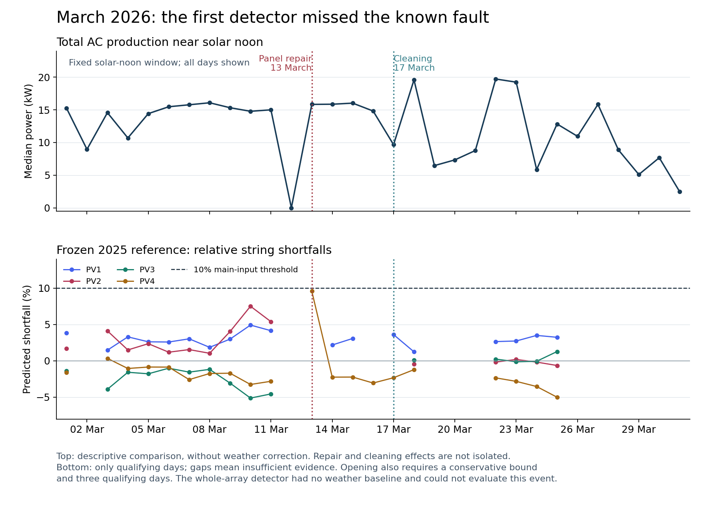

# PV performance prototype: March 2026 validation

**Result: the known broken-panel event was not flagged. The prototype is not
validated for this fault and is not ready for operational performance alerts.**

The user noticed low **total production**. The first replay mainly tested
relative input performance, so its negative result did not adequately test that
symptom. A separate whole-array replay using independent weather estimates sees
a sustained shortfall, but also fails the current alert rule. Both outcomes are
preserved; no threshold was lowered to make March pass.



## First replay: fixed before evaluating March

- Reference: 1 January–31 December 2025, using only inverter exports acquired
  before 1 January 2026. Five later exports were excluded. There are 58,009 unique
  reference samples from 33 exports.
- Evaluation: 1 January–31 October 2026, 47,121 unique observations from Pi logs.
  Legacy receipt timestamps were explicitly allowed; the replay reports their
  weaker provenance and other exclusions.
- Policy and reference stayed fixed. The repair date was not supplied to the
  predictor or used to pick a threshold. It was already known to the analyst,
  so this is a chronological replay, not a blind or preregistered study.
- Main inputs require a conservative shortfall of at least 10% on three
  qualifying days within 14 calendar days. Each day needs at least an hour of
  matched samples spanning two solar-hour bins. Prediction bounds describe
  historical variation, not calibrated confidence intervals.
- Outcome: **zero candidates**, including before the repair. There were ten
  qualifying days on every main input during 1–12 March. The whole-array branch
  had **zero qualifying days** because the reference exports contain no weather.

Median daily shortfall in matched windows; negative means output exceeded the
reference prediction. The repair day is excluded from both columns.

| Logged input | 1–12 March | 14–31 March | Qualifying days, before / after |
| --- | ---: | ---: | ---: |
| PV1 | 3.01% | 2.91% | 10 / 8 |
| PV2 | 2.02% | -0.17% | 10 / 5 |
| PV3 | -1.68% | 0.08% | 10 / 5 |
| PV4 | -1.66% | -2.34% | 10 / 9 |

The small relative PV2 improvement is suggestive. It does not identify the
repaired physical string: notebook and telemetry labels remain unresolved.
There are no independently labelled healthy control periods, so zero candidates
does not establish a false-positive rate. The 2025 reference may itself contain
the fault, whose onset is unknown.

A separate fixed positive control reduced predicted-window target output by
20% during 1–14 June, leaving all references and eligibility unchanged. All four
main inputs opened candidates on 7 or 8 June. This verifies that the replay can
trigger, but is a residual-only perturbation, not an electrical fault simulation
or evidence that real broken panels will be detected.

## Why low total production can be missed

Relative comparisons divide one input's output by another input's output.
A reduction shared by both inputs can cancel. There is a clear descriptive
change in the raw total-production curves: median power near solar noon was
15.33 kW on 9 March, 15.86 kW on 14 March, and 19.59 kW on 18 March. All six active
inputs increased between the latter two dates. These dates illustrate the
pattern; the chart shows every observed March day, not just these examples.

There are **no matched local weather observations in February or March 2026**.
The notebook records panel repair on 13 March and cleaning on 17 March. Weather,
season, cleaning and repair effects therefore cannot be separated from the raw
production curves alone. The logs also show zero total production on 12 March;
that is a separate observation, not proof of a panel fault.

## Follow-up whole-array development replay

`pv_array_weather.py` adds an explicit experimental comparison using independent
hourly ERA5 radiation and temperature from
[Open-Meteo](https://open-meteo.com/en/docs/historical-weather-api). Radiation
represents the preceding hour's mean; PV samples are joined to that same hour.
The estimates represent a regional grid, not measurements at the roof. These
retrospective data were fetched on 1 November 2026, so their use is not an exact
replay of weather information available on each historical day.

The new method was chosen after reviewing the March miss. Its policy was then
frozen before its first evaluation; it is **post-hoc development**, not a new
independent validation success. Reference production remains exclusively 2025.
Evaluation covers 1 January–26 October 2026. Twelve nearby reference hours on
at least five days are required, matching sun position, radiation, diffuse
fraction and temperature. A day needs three matched hours. The alert rule uses
20% conservative loss on three qualifying days in 14 days.

There were 180 qualifying evaluation days. During 1–11 March, ten days qualified
and their median shortfall was **10.05%**. The 12 March shutdown was excluded
only from this summary; it was retained in scoring. There were **zero candidate
episodes**. Historical prediction bounds were broad enough that the repeated
smaller shortfalls did not satisfy the per-day conservative threshold.

This identifies a design limitation: the current persistence rule requires
several individually large shortfalls. It does not accumulate weaker evidence
of a small persistent loss. Waiting longer alone cannot fix that. A subsequent
revision needs a calibrated accumulation rule and independent array reference,
tested against background periods and new held-out evidence. March can remain
a regression case, but cannot become an untouched test set again.

## Artifacts and reproduction

- `pv_performance_validation_2026.json`: immutable first-run results, policy
  description, source hashes, model ID, daily March residuals, positive control
  and descriptive total-production aggregates.
- `pv_array_weather_validation_2026.json`: separate follow-up results, every
  daily decision, policy, source hashes, weather URL and response hash.
- `plot_pv_performance_validation.py`: regenerates the chart from saved
  aggregate results only; requires matplotlib. The monitor uses the standard
  library and does not require matplotlib.

The first reference was built from the user-supplied notebook export directory
`C:/Users/Beno/Documents/SZAKI/dev/kazanaram/input/pv/his_inv/extracted`.
Evaluation logs were read on `pi@phoscon`, under
`/media/pi/program_stick/kazanfutes/data/logs`. Code and references were streamed
to an in-memory Python process. No Pi files or devices were changed.

Where the required input paths are available, the first replay is reproduced
with the following commands (dates are end-exclusive; choose new output paths):

```text
python -B -m services.pv_performance_monitor baseline --history-exports EXPORTS --from 2025-01-01 --until 2026-01-01 --output BASELINE.json
python -B -m services.pv_performance_monitor replay --logs LOGS --model BASELINE.json --from 2026-01-01 --until 2026-11-01 --allow-legacy-timestamps --output REPLAY.json
```

The separate development replay downloads public weather explicitly:

```text
python -B -m services.pv_array_weather_replay --history-exports EXPORTS --logs LOGS --reference-from 2025-01-01 --reference-until 2026-01-01 --from 2026-01-01 --until 2026-10-27 --allow-legacy-timestamps --output ARRAY-REPLAY.json
```

The saved files are evidence, not tests that require the known event to pass.
Automated tests use synthetic observations for timing, missing data, independent
references, state transitions and persistence. No replay sends notifications or
installs a scheduled service. The experimental ERA5 method is not wired into the
shadow monitor.

Publication remains pending: this checkout has pre-existing changes outside
these additions and is 216 commits behind the fetched `origin/main`. The
approved sync routine refuses to include unrelated changes without approval.
No local edits were discarded and no GitHub or Pi deployment was performed.
